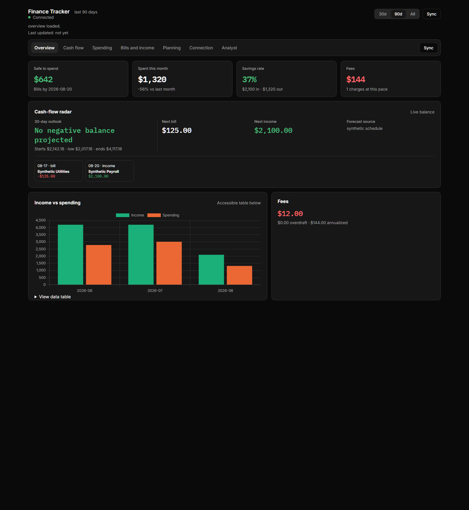
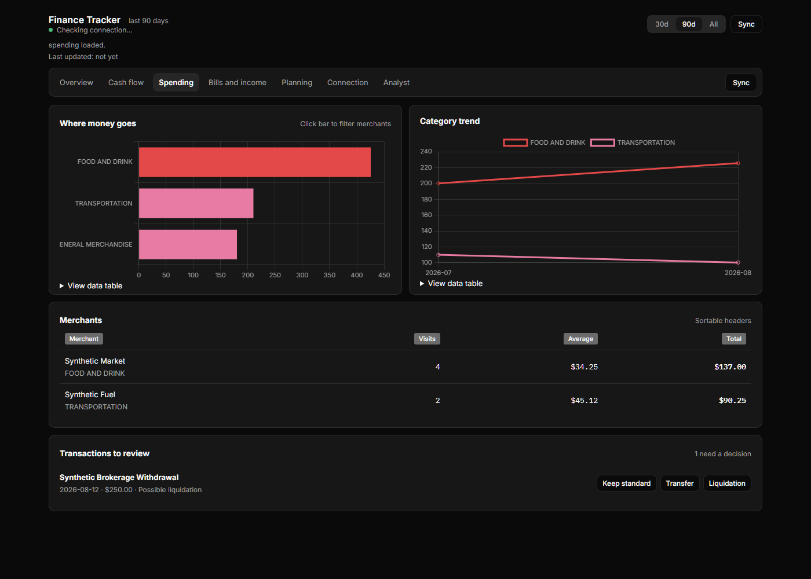
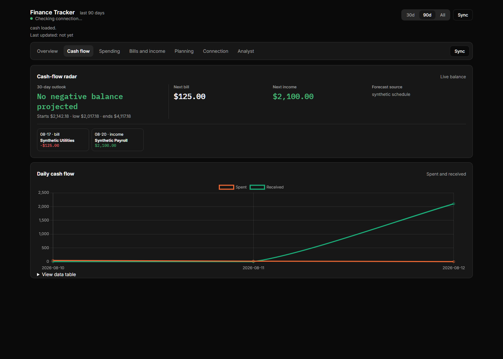
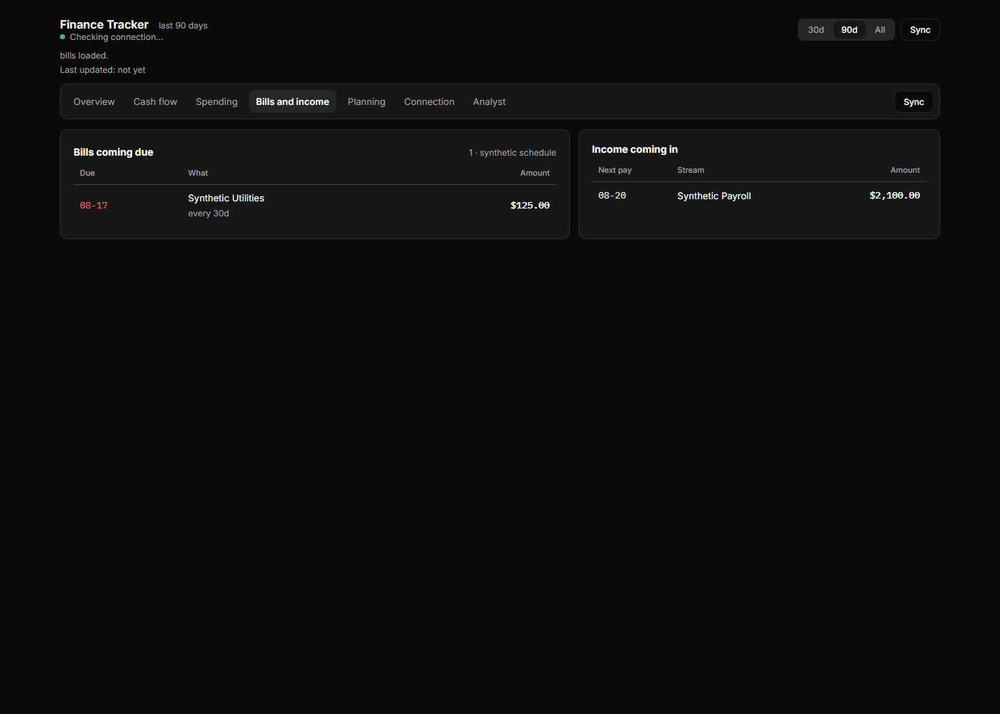

# Finance Tracker

A personal cash-flow tracker. It pulls bank transactions through the Plaid API into a local SQLite database and turns them into a 30-day forecast, so you can see a shortfall before it happens.

Single user, runs on localhost. All screenshots below use synthetic data.



## What it does

- **Cash-flow radar:** projects the balance 30 days ahead from the live balance, recurring bills and expected income, and flags the first day it would go negative.
- **Purchase check:** shows how a planned purchase changes the forecast before you spend.
- **Spending:** categories, category trends, sortable merchants, and a review queue for transactions that need a decision (transfer, liquidation or ordinary spending).
- **Bills and income:** recurring schedules from Plaid, with a synthetic fallback for demos.
- **Fees:** overdraft and bank fees, annualized over the selected window.
- **Analyst:** optional chat that answers questions about your own numbers through an LLM API.
- **Conservative classification:** payroll is never hidden as a transfer, and person-to-person payments stay visible until you confirm they are your own.

| Spending | Cash flow | Bills and income |
|---|---|---|
|  |  |  |

## Stack

- Python, Flask, plain `sqlite3`
- Plaid API (Transactions, Balance, Recurring)
- Chart.js dashboard with accessible data tables for every chart
- `unittest` suite (83 tests)

## Run it

```bash
pip install -r requirements.txt
cp .env.example .env        # add Plaid sandbox keys
python app.py               # http://localhost:5000
```

To see the dashboard without a bank connection, run `python synthetic_dashboard.py` (http://localhost:5055).

## Tests

```bash
python -m unittest discover
```

Two tests use fixed August 2026 dates against a rolling window and fail when run later; they are tracked as a known issue.

## Privacy

Transactions live only in the local `finance.db`, which is gitignored along with `.env`. This public copy contains code and synthetic data only.
